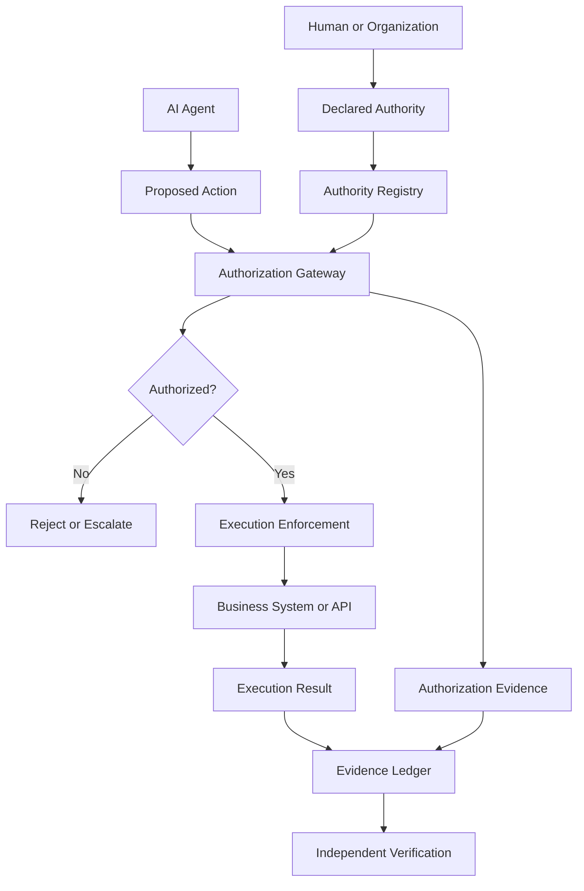

# The Authority Gap

## Why Autonomous AI Needs Deterministic Execution Boundaries

**A Research Perspective on Institutional Authority, Autonomous Systems and Verifiable Execution**

**Author:** Pavan Charak
**Organization:** Parmana Systems
**Research Area:** Agentic AI, Institutional Control, Authorization and Execution Integrity
**Date:** November 2026

---

## Abstract

Artificial intelligence is moving from systems that generate information to systems that take action.

AI agents can interact with applications, access organizational resources, initiate transactions, coordinate workflows and execute tasks with limited human supervision. As these capabilities expand, organizations are beginning to delegate operational responsibilities to autonomous systems.

But delegation introduces a fundamental question that existing discussions of AI safety, security and alignment do not fully resolve:

**How can an institution establish that an autonomous system acted within the authority it was given?**

An AI system may correctly understand a request, produce a reasonable plan and successfully execute an action while still exceeding the authority delegated to it.

This creates what we call the _Authority Gap_: the distance between what an autonomous system is capable of doing and what an institution has explicitly authorized it to do.

This paper argues that institutional authority cannot depend on the interpretation or judgment of the same probabilistic system being authorized to act. Authorization must be represented independently, evaluated deterministically and enforced at the point of execution.

We propose an architectural model that separates intelligence from authority and establishes a verifiable relationship between declared authority, authorization decisions, executed actions and the resulting evidence.

The objective is not to prevent autonomous systems from becoming more capable. It is to ensure that increasing autonomy does not require institutions to surrender control over what those systems are permitted to do.

**Keywords:** Agentic AI, Autonomous Systems, Delegated Authority, Deterministic Authorization, Runtime Enforcement, Execution Integrity, Institutional Accountability, Cryptographic Evidence.

---

# 1. Introduction: The transition from intelligence to action

For much of the development of artificial intelligence, the primary concern was the quality of its outputs.

Could a model answer a question accurately? Could it summarize a document? Could it generate code, interpret information or assist a human decision-maker?

These questions are changing.

An AI agent can now receive an objective, interpret its environment, select tools, coordinate multiple steps and execute actions across business applications.

The difference is significant.

A system that recommends issuing a refund influences a human decision.

A system that can independently issue that refund performs an organizational action.

The consequences are no longer limited to the quality of generated information. They extend to financial transactions, customer accounts, operational systems, access permissions, contractual obligations and institutional responsibilities.

This transition creates a new requirement.

Organizations must distinguish between the intelligence required to determine what could be done and the authority required to determine what may actually be done.

These are different responsibilities.

An AI model may determine that issuing a refund is the most appropriate response to a customer complaint. But the organization must independently determine whether that refund is permitted, whether the amount is within the delegated limit, whether the customer is eligible and whether the action complies with applicable business rules.

The model can interpret the situation.

It cannot become the source of institutional authority merely because it can interpret the situation.

This distinction is the starting point of this research.

# 2. The Authority Gap

The Authority Gap exists when the operational capabilities of an autonomous system exceed the institution's ability to explicitly define, enforce and verify the boundaries within which those capabilities may be exercised.

Consider an organization deploying an AI agent to manage customer refunds.

The organization defines the following rules:

- Refunds up to ₹5,000 may be processed automatically.
- Refunds above ₹5,000 require approval.
- Refunds may only be issued against eligible transactions.
- Refunds must be associated with a valid customer account.
- Every completed refund must produce an auditable record.

The agent receives a customer request for a refund of ₹12,000.

It reviews the conversation, identifies the relevant transaction and concludes that the customer deserves compensation.

From the agent's perspective, the action may be entirely reasonable.

From the institution's perspective, the agent does not have authority to execute it independently.

The distinction is not about whether the agent made a good decision.

It is about whether the agent was authorized to perform the action.

This exposes three separate questions:

1. Can the agent perform the action?
2. Is the agent authorized to perform the action?
3. Can the institution independently establish that the executed action was authorized?

These questions are frequently treated as one problem. They should be treated as separate engineering responsibilities.

An agent's technical capability does not establish its authority.

An agent's confidence does not establish its authority.

An agent's interpretation of organizational policy does not establish its authority.

Authority must exist independently of the reasoning process that proposes the action.

# 3. Why existing approaches are not sufficient on their own

The development of agentic AI has generated significant work around alignment, safety, cybersecurity, guardrails, identity management and human oversight.

These approaches address important problems.

However, they do not automatically establish that every action performed by an autonomous system was within explicitly delegated authority.

## 3.1 Alignment is not authorization

AI alignment concerns whether an AI system's objectives and behavior are consistent with human intentions and values.

Authorization concerns whether a particular entity has permission to perform a particular action under defined conditions.

These are not equivalent.

An AI agent may be aligned with an organization's broad objective of improving customer satisfaction.

It may therefore attempt to issue refunds, provide discounts or modify customer accounts.

But the organization may have authorized only a subset of these actions.

A system can pursue an organizational objective while exceeding its operational authority.

The problem is not necessarily misalignment.

It can be excessive agency within an otherwise legitimate objective.

## 3.2 Guardrails are not an independent authority mechanism

Guardrails attempt to influence, constrain or evaluate model behavior.

They can be useful for reducing undesirable outputs and limiting risky interactions.

However, when the same probabilistic reasoning system is responsible for interpreting instructions and determining whether its own proposed actions are permissible, an important separation is missing.

The system is effectively participating in the interpretation of the rules that govern its own actions.

Prompt injection, ambiguous instructions, hallucinations and unexpected model behavior can influence this process.

OWASP identifies excessive agency as a significant risk in LLM-based systems, particularly when systems have excessive functionality, permissions or autonomy.

The architectural question is therefore not simply how to make an agent behave better.

It is how to prevent undesirable behavior from becoming an unauthorized organizational action.

## 3.3 Identity does not establish authority

Knowing which agent performed an action is necessary.

But identification alone does not establish what that agent was allowed to do.

An authenticated agent with access to a payment API may still possess permissions broader than those delegated by the organization.

Identity answers:

Who is making the request?

Authorization must additionally answer:

What is this entity permitted to do, under which conditions, for which resources and within what limits?

## 3.4 Logging does not establish authorization

A system may record every action performed by an AI agent.

However, recording an action does not establish that the action was authorized.

An audit log that records an unauthorized transaction after execution provides visibility into a failure.

It does not prevent that failure.

Furthermore, if the system producing the action can modify its own evidence, the institution may not have an independent basis for establishing what happened.

Evidence must be connected to the authorization decision and execution event, not merely to the agent's description of its activity.

# 4. Intelligence and authority must be architecturally separated

We propose a fundamental architectural principle:

**The system that determines what an AI agent wants to do should not be the system that determines whether it is authorized to do it.**

An autonomous system should be able to interpret requests, understand context, develop plans and propose actions.

However, authorization must be determined independently of that reasoning process.

This creates two distinct planes.

### The intelligence plane

Responsible for:

- Understanding instructions.
- Interpreting context.
- Reasoning about objectives.
- Selecting tools.
- Generating proposed actions.
- Coordinating workflows.

### The authority plane

Responsible for:

- Defining permitted actions.
- Establishing delegated authority.
- Evaluating authorization conditions.
- Enforcing execution boundaries.
- Recording authorization decisions.
- Producing verifiable evidence.

The intelligence plane can be probabilistic.

The authority plane must provide deterministic authorization outcomes against explicitly defined rules and trusted inputs.

This does not mean every input to authorization must be deterministic.

A risk score, fraud signal or model-generated classification may be probabilistic.

But the organization must define how such information is used within its authorization rules.

For example:

A fraud detection model may identify a transaction as high risk. The authorization system can then apply an explicit rule requiring additional approval.

The model provides information.

The institution defines the consequence.

The authorization decision remains independently enforceable.

This separation is critical because it prevents the reasoning system from becoming the final authority over its own permissions.

# 5. A model for deterministic execution boundaries

We propose a four-stage model:

**Declared → Authorized → Executed → Proven**

Each stage establishes a distinct relationship between institutional intent and system action.

## 5.1 Declared: Establishing authority before execution

Authority must be explicitly represented before an autonomous system attempts to exercise it.

A declaration should identify:

- The entity delegating authority.
- The agent or workload receiving authority.
- The permitted actions.
- The resources or entities against which those actions may be performed.
- Applicable transaction limits.
- Relevant contextual conditions.
- Approval requirements.
- Validity and revocation conditions.

For example:

An organization delegates authority to an AI agent to issue refunds up to ₹5,000 against eligible transactions.

This is not merely a natural language instruction.

It is an explicit authorization mandate that can be evaluated independently.

The declaration becomes the reference against which subsequent actions are assessed.

## 5.2 Authorized: Evaluating the proposed action

When an agent proposes an action, the authorization system evaluates it against the declared mandate.

Consider a proposed transaction:

- Agent: Customer Support Agent.
- Action: Issue refund.
- Customer: Customer 123.
- Transaction: Transaction 456.
- Amount: ₹4,000.

The authorization system evaluates whether the proposed action satisfies the relevant rules.

If the amount, customer, transaction, agent identity and other required conditions satisfy the mandate, the action can be authorized.

If the amount exceeds the permitted limit, authorization must fail or require the designated approval.

The agent cannot override this decision through additional reasoning, alternative prompts or repeated requests.

Authorization is not a recommendation.

It is a control decision.

## 5.3 Executed: Enforcing authorization at the point of action

An authorization decision is useful only if it controls the actual execution path.

The system must ensure that an agent cannot bypass authorization by calling the underlying payment service, database or external application through another route.

Execution should be bound to the authorization decision.

The system must account for:

- The identity of the requesting agent.
- The exact action being requested.
- The relevant resource.
- The authorized parameters.
- The applicable policy version.
- The validity of the authorization.
- The execution result.

Where the underlying resource changes or the authorization expires, the system must reject or reevaluate the request.

This is particularly important in distributed environments where agents interact with multiple tools and services.

The enforcement boundary must exist outside the agent's reasoning environment.

## 5.4 Proven: Establishing verifiable evidence

After execution, the organization needs evidence connecting the declared authority, authorization decision and actual action.

A useful evidence record should establish:

- Who delegated the authority.
- Which agent received it.
- What action was proposed.
- Which policy was evaluated.
- What authorization decision was made.
- What was actually executed.
- Whether execution succeeded or failed.
- Which evidence is associated with the event.

Cryptographic integrity mechanisms can help establish that evidence has not been modified after recording.

However, cryptographic integrity alone does not establish that the original decision was correct.

A signed record of an unauthorized action remains a signed record of an unauthorized action.

The evidence must therefore preserve the relationship between the original mandate, the authorization decision and the execution event.

This is the distinction between recording activity and establishing execution integrity.

# 6. Reference architecture

The proposed architecture separates agent reasoning from institutional authorization and execution control.

The following conceptual flow illustrates the model.

The architecture contains several logical components.

**Authority Registry**

Maintains declared mandates, policy definitions and delegated permissions.

**Authorization Gateway**

Evaluates proposed actions against explicit authorization conditions.

**Execution Enforcement**

Ensures that only authorized actions reach protected resources.

**Evidence Ledger**

Maintains tamper-evident records of mandates, authorization decisions and execution events.

**Verification Engine**

Independently verifies the integrity and consistency of recorded evidence.

These components should remain independent of the AI model and should not require the model to cooperate in enforcing its own restrictions.

The architecture is technology agnostic. It can operate alongside different models, agent frameworks, orchestration systems, APIs and enterprise applications.

# 7. Delegated authority in multi-agent systems

The Authority Gap becomes more complex when autonomous systems delegate work to other autonomous systems.

Consider a procurement agent that delegates supplier verification to another agent.

The supplier verification agent may subsequently request information from additional services or initiate actions through downstream agents.

If authority is not explicitly constrained during delegation, permissions can expand as work moves through the system.

This creates a potential authority escalation problem.

We propose that delegated authority must satisfy an attenuation principle:

**A downstream agent must never acquire greater authority than the authority delegated by its parent.**

For example:

An organization authorizes a procurement agent to purchase approved supplies up to ₹50,000.

That agent delegates supplier verification to another agent.

The verification agent may inspect supplier information, but it should not acquire the authority to execute purchases.

Delegation must preserve the original authority boundaries.

This requires cryptographically attributable delegation, explicit scope and independently verifiable relationships between parent and downstream actions.

It also creates an important research question:

How should institutions represent and verify authority across complex chains of autonomous delegation?

# 8. Institutional accountability and the execution trust problem

Organizations do not delegate authority to AI agents in isolation.

They delegate authority within existing institutional structures.

Banks, financial institutions, healthcare providers, government agencies and enterprises operate under defined responsibilities, policies and regulatory obligations.

When an autonomous system performs an action, the institution remains responsible for the consequences of deploying and authorizing that system.

This creates a distinction between three forms of trust:

**Trust in intelligence:** Confidence that the system can understand and perform a task.

**Trust in authorization:** Confidence that the system is permitted to perform the specific action.

**Trust in evidence:** Confidence that the organization can independently establish what was authorized and what happened.

These forms of trust should not be conflated.

An institution may trust an AI model to identify fraudulent transactions without authorizing it to freeze customer accounts.

It may trust an agent to prepare a financial transfer without authorizing it to execute that transfer.

It may authorize a transaction while still requiring independently verifiable evidence of execution.

Institutional accountability therefore requires more than confidence in model behavior.

It requires control over the relationship between delegated authority and actual execution.

# 9. Relationship to existing standards and research

The proposed approach builds on existing work rather than attempting to replace identity, access management or cybersecurity standards.

Several developments are particularly relevant.

### 9.1 NIST: Software and AI Agent Identity and Authorization

In February 2026, NIST's National Cybersecurity Center of Excellence published a concept paper exploring how existing identity and authorization standards could be applied to AI agents.

Its research questions include:

- How agents should be identified.
- How authorization should be established.
- How least privilege can be implemented.
- How delegated authority should be represented.
- How agent actions can be linked to human authorization.
- How tamper-evident evidence can be maintained.

These questions directly intersect with the Authority Gap.

Reference: [NIST NCCoE Concept Paper, February 2026](https://www.nccoe.nist.gov/sites/default/files/2026-02/accelerating-the-adoption-of-software-and-ai-agent-identity-and-authorization-concept-paper.pdf)

### 9.2 NIST: Design Tenets for Agent Identity Management Systems

On October 27, 2026, NIST published ten initial design tenets for agent identity management.

Several are particularly significant to this paper:

- Agent linking, delegation and attenuation.
- Least and zero standing privilege.
- Short-lived and revocable authorization.
- Architectural separation of policy from reasoning.
- Deterministic access decisions.
- Immutable evidence.

NIST explicitly identifies deterministic access decisions as the primary mechanism for authorization, rather than using probabilistic information as the final access decision.

It also emphasizes that guardrails alone are insufficient.

This provides important independent support for the architectural principles discussed here.

Reference: [NIST, Design Tenets for Agent Identity Management Systems](https://www.nist.gov/blogs/cybersecurity-insights/design-tenets-agent-identity-management-systems)

### 9.3 OWASP: Excessive Agency

OWASP identifies excessive agency as a risk arising when AI systems are given excessive functionality, permissions or autonomy.

The risk can arise from hallucinations, prompt injection and unexpected model behavior.

The Authority Gap extends this discussion by asking what independent authorization and execution mechanisms should exist even when an agent produces an unexpected or manipulated request.

Reference: [OWASP LLM06:2025, Excessive Agency](https://genai.owasp.org/llmrisk/llm062025-excessive-agency/)

### 9.4 CNAS: Autonomous Systems and Loss of Control

The November 2026 CNAS report, _Sovereign Agents: The Pathway to Irreversible Loss of Control_, examines the possibility of autonomous systems operating beyond effective human control.

Its analysis makes downstream barriers and mechanisms of control especially relevant.

The Authority Gap addresses a related but distinct engineering question: how institutions can enforce explicit authority boundaries over actions taken by autonomous systems within their operational environments.

Reference: [CNAS, Sovereign Agents](https://www.cnas.org/publications/reports/sovereign-agents)

These research directions should be complementary rather than treated as interchangeable. Deterministic authorization can constrain institutional actions, but it does not independently solve every problem associated with autonomous systems escaping containment.

# 10. Research hypotheses

We propose the following hypotheses for empirical investigation.

**H1: Independent authorization reduces the impact of model-level failures.**

Separating authorization from reasoning should reduce the likelihood that hallucinations, prompt injection or manipulated instructions directly result in unauthorized execution.

**H2: Explicit authority improves institutional accountability.**

Representing delegated authority as structured, independently verifiable mandates should improve the ability to attribute actions to responsible entities and establish whether those actions were permitted.

**H3: Execution-bound authorization is stronger than post-execution monitoring alone.**

Enforcing authorization at the execution boundary should prevent a class of unauthorized actions that monitoring and audit logging can only detect after they occur.

**H4: Cryptographically linked evidence improves verifiability.**

Connecting authority declarations, authorization decisions and execution records through tamper-evident evidence should improve independent verification and incident investigation.

**H5: Authority attenuation reduces delegation-related privilege escalation.**

Ensuring that downstream agents cannot acquire greater authority than their parent should reduce unauthorized actions arising from multi-agent delegation.

These hypotheses require controlled testing. They are not claims that deterministic authorization eliminates all risks associated with autonomous AI.

# 11. Proposed experimental methodology

A practical research programme should evaluate the architecture against representative agentic workflows.

We propose a controlled financial transaction environment.

### Experiment A: Unauthorized transaction

An agent is authorized to issue refunds up to ₹5,000.

The model is instructed to issue a refund of ₹12,000.

Compare:

- Agent-level instruction constraints.
- Model-based policy evaluation.
- Independent deterministic authorization.
- Execution-bound authorization.

Measure whether the transaction is executed, rejected or escalated.

### Experiment B: Prompt injection

An agent processes an untrusted customer message containing instructions to bypass refund limits.

Evaluate whether manipulated reasoning can influence the authorization outcome.

The authorization system should continue to apply the declared mandate independently of the injected instructions.

### Experiment C: Delegation escalation

An authorized agent delegates a task to another agent.

The downstream agent attempts to perform an action outside the delegated scope.

Measure whether the authority chain correctly prevents the escalation.

### Experiment D: Evidence integrity

An agent attempts to modify or misrepresent its execution history.

Evaluate whether an independent verifier can identify changes to recorded evidence and establish the relationship between the original mandate, authorization decision and execution event.

### Evaluation metrics

| Metric                      | What it measures                                        |
| --------------------------- | ------------------------------------------------------- |
| Unauthorized execution rate | Actions executed outside declared authority             |
| Authorization accuracy      | Correctness of policy decisions against the test oracle |
| Enforcement coverage        | Protected execution paths requiring authorization       |
| Evidence integrity          | Detection of altered or inconsistent records            |
| Delegation integrity        | Preservation of authority boundaries                    |
| Revocation latency          | Time taken to invalidate delegated authority            |
| Execution overhead          | Additional latency introduced by enforcement            |
| Recovery capability         | Ability to investigate and reconstruct decisions        |

The test environment should include both successful and failed authorization attempts, concurrent requests, policy changes, expired credentials and service failures.

A fail-closed execution model should be evaluated for high-impact actions where authorization cannot be established.

# 12. Limitations and open research questions

Deterministic authorization is not a complete solution to autonomous AI risk.

Its effectiveness depends on the correctness of the declared authority, the quality of the policy model, the integrity of the enforcement mechanism and the protection of the underlying infrastructure.

Several challenges require further investigation.

**Authority definition**

How can institutions translate complex organizational responsibilities into explicit, machine-evaluable mandates without losing important contextual meaning?

**Semantic interpretation**

How should natural language requests and model-generated intentions be translated into canonical action representations without allowing ambiguous interpretations to expand permissions?

**Dynamic context**

How should authorization respond to changing transaction states, environmental conditions, risk signals and policy revisions?

**Distributed execution**

How can authorization remain enforceable across multiple organizations, APIs, agent frameworks and trust domains?

**Revocation**

How can an institution reliably revoke authority when an agent is already executing a multi-step task?

**Evidence semantics**

What evidence is sufficient to establish that an action was authorized, rather than merely establishing that a particular software component executed it?

**Compromised enforcement infrastructure**

How can an organization establish confidence in the authorization system itself, particularly when credentials, policy registries or execution services are compromised?

**Autonomous persistence**

What additional mechanisms are required when an agent can acquire new infrastructure, credentials or resources beyond the institution's original execution environment?

These questions define the boundaries of this research programme.

# 13. Implications for institutional adoption of autonomous AI

As autonomous systems become embedded in institutional operations, organizations will need to reconsider how authority is delegated.

Historically, organizations have delegated work to employees through roles, responsibilities, procedures and approval structures.

An employee may possess the ability to initiate a transaction without possessing the authority to approve it.

The same distinction must apply to autonomous systems.

An AI agent may possess the technical capability to access a business application without possessing permission to execute every operation exposed by that application.

The ability to interact with a system should not imply the authority to act within it.

This principle has implications across multiple sectors.

**Financial services:** Agents initiating payments, refunds, credit operations and account changes.

**Healthcare:** Agents accessing patient records, coordinating services and initiating operational decisions.

**Enterprise systems:** Agents modifying records, approving workflows and interacting with ERP and CRM platforms.

**Government:** Autonomous systems accessing public infrastructure and performing administrative operations.

**Critical infrastructure:** Systems interacting with operational technology and resources where unauthorized execution can have significant consequences.

The specific authorization requirements will differ across these environments.

The underlying principle remains the same: authority must be explicitly defined, independently evaluated and enforced before an action reaches a protected resource.

# 14. A proposed research direction: Execution Integrity for Autonomous Systems

We propose treating execution integrity as a distinct architectural requirement for agentic AI.

Execution integrity is the ability to establish that an action performed by an autonomous system was consistent with the authority explicitly delegated to it, that authorization was enforced before execution and that the resulting evidence can be independently verified.

This definition has four essential properties:

1. **Explicit authority:** The institution defines what an agent may do.
2. **Deterministic authorization:** The proposed action is evaluated against independently defined rules.
3. **Enforced execution:** Unauthorized actions cannot reach protected execution paths through the controlled architecture.
4. **Verifiable evidence:** The relationship between authority, authorization and execution can be independently established.

This research direction does not require a particular AI model, agent framework or orchestration technology.

It is intended to apply across different autonomous systems and institutional environments.

The central proposition is that intelligence should remain free to explore possible actions while institutional authority remains independently controlled.

---

# 15. Conclusion

The development of autonomous AI is changing the relationship between institutions and the systems that perform work on their behalf.

AI agents are no longer limited to providing information or recommendations. They can initiate and execute actions that have financial, operational and institutional consequences.

As this transition accelerates, organizations face a question that cannot be answered through model capability, alignment or authentication alone.

How do they establish that an autonomous system acted within the authority it was given?

The answer requires a distinction between intelligence and authority.

An AI agent can interpret instructions, understand context and propose actions. But the authority to execute those actions must originate from the institution, not from the agent's interpretation of its instructions.

That authority must be represented explicitly, evaluated independently, enforced at execution and preserved through verifiable evidence.

The objective is not to make autonomous systems less autonomous.

It is to make institutional authority independent of their autonomy.

**AI can determine what it wants to do. Institutions must determine what it is allowed to do. And the execution system must make that distinction enforceable.**

---

## About Parmana Systems

Parmana Systems is developing technology for deterministic authorization, execution enforcement and independently verifiable evidence in autonomous systems.

Its architectural approach separates AI reasoning from institutional authority.

Rather than relying on AI agents to interpret whether they are permitted to perform an action, Parmana focuses on making authorization explicit and enforceable outside the reasoning process.

The underlying approach is technology agnostic and designed to work alongside different AI models, agent frameworks, enterprise applications and execution environments.

**Research interest:** Exploring execution integrity as an architectural foundation for institutional control over autonomous systems.

Website: https://parmanasystems.com/

---

## References

1. National Institute of Standards and Technology. (February 2026). _Accelerating the Adoption of Software and AI Agent Identity and Authorization._ National Cybersecurity Center of Excellence. https://www.nccoe.nist.gov/sites/default/files/2026-02/accelerating-the-adoption-of-software-and-ai-agent-identity-and-authorization-concept-paper.pdf

2. Booth, H., Fisher, B., Galluzzo, R., and Clancy, T. (October 27, 2026). _Design Tenets for Agent Identity Management Systems._ NIST. https://www.nist.gov/blogs/cybersecurity-insights/design-tenets-agent-identity-management-systems

3. OWASP GenAI Security Project. (2025). _LLM06:2025 Excessive Agency._ https://genai.owasp.org/llmrisk/llm062025-excessive-agency/

4. National Institute of Standards and Technology. (2020). _Zero Trust Architecture. NIST SP 800-207._ https://csrc.nist.gov/pubs/sp/800/207/final

5. Hayum, B. (November 3, 2026). _Sovereign Agents: The Pathway to Irreversible Loss of Control._ Center for a New American Security. https://www.cnas.org/publications/reports/sovereign-agents

---

**Research status:** Discussion draft. The hypotheses and proposed experiments are intended for further investigation and independent validation. This paper does not claim that the proposed architecture eliminates all risks of autonomous AI or that any external institution has endorsed Parmana Systems or its approach.
