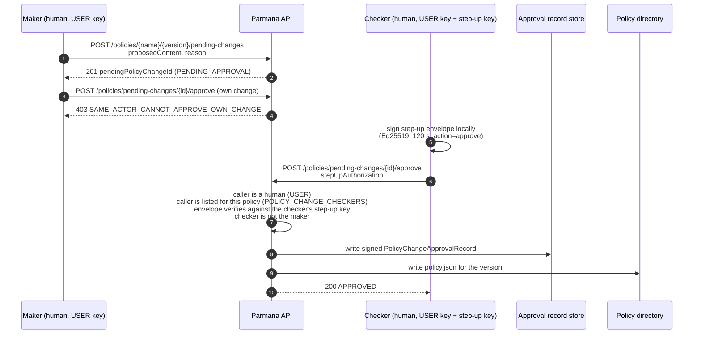
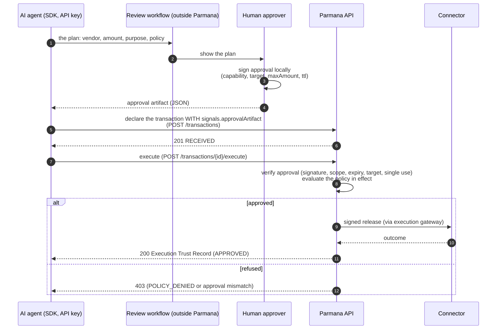
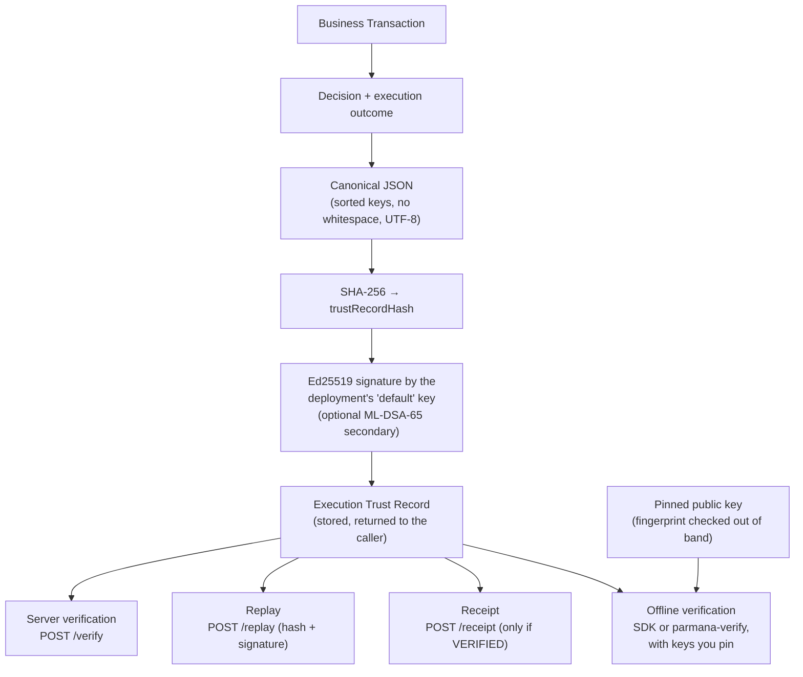
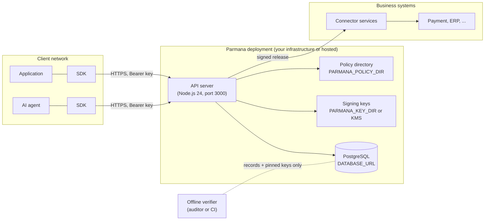

# Architecture

[Portal home](README.md) · [Overview](overview.md) · [Security](security/README.md)

This page shows how a request moves through Parmana, where the trust boundaries are, which steps are synchronous, and where asynchronous work happens. The request path is written as numbered steps. The other diagrams are Mermaid, and they render on GitHub and in most Markdown viewers.

## Components

| Component                                                                  | Where it lives                                                   | What it does                                                                                                                                                          |
| -------------------------------------------------------------------------- | ---------------------------------------------------------------- | --------------------------------------------------------------------------------------------------------------------------------------------------------------------- |
| **Application or agent**                                                   | Your code                                                        | Builds the Business Transaction and calls an SDK. Never holds the approver's key.                                                                                     |
| **SDK** (`@parmana/sdk`, `parmana`)                                        | Your process                                                     | Builds and sends HTTP requests. Checks the endpoint is `https` (or loopback). Holds the caller's API key. Also contains the offline verification and signing helpers. |
| **API server** (`packages/api`)                                            | Parmana deployment                                               | Authenticates the caller, validates the request, runs the runtime, writes the record, signs, and serves verification, replay and receipts.                            |
| **Runtime** (`packages/runtime`)                                           | Inside the API server                                            | Loads the policy version in effect, evaluates it, and checks the signals and the human approval.                                                                      |
| **Policy engine** (`packages/policy`)                                      | Inside the runtime                                               | Evaluates the rules in order, pure and deterministic. First matching rule wins.                                                                                       |
| **Governance** (`packages/api/src/governance`)                             | Inside the API server                                            | Records proposed policy changes, checks the checker's step-up envelope, and writes the approval record.                                                               |
| **Execution gateway** (`packages/execution-gateway`)                       | Inside the API server                                            | The only path through which an approved request is released to a connector. Re-verifies the signed authorization before release.                                      |
| **Connector** (`parmana-connectors`)                                       | A separate service, reached over the network                     | Performs the business call (for example a payment). Receives signed releases only.                                                                                    |
| **Storage**                                                                | PostgreSQL (`DATABASE_URL`) or memory (`PARMANA_STORAGE=memory`) | Business transactions, trust records, approval records, audit events. Memory is for local runs only.                                                                  |
| **Offline verifier** (`@parmana/verifier`, or the SDK's offline functions) | Anywhere you choose                                              | Checks a record against keys you pin. Needs no network access and no Parmana service.                                                                                 |

## 1. Request path: application → SDK → service → decision → execution

1. The application or agent builds a Business Transaction and passes it to the SDK (`@parmana/sdk`, `parmana`).
2. The SDK sends it to the Parmana API over HTTPS with `Authorization: Bearer`.
3. The API checks that the caller is authenticated, is allowed to act for this principal, and is allowed to invoke this action. If not, it returns `403` or `401`. Nothing is stored as executed, and the request stops here.
4. The API checks that the structure is valid and that the ID has not been used before. If not, it returns `400` or `409`, and the request stops here.
5. The runtime loads the policy version in effect, which is the latest approved version for the policy name.
6. Policy evaluation checks the signals against bindings, sources, and approval rules.
7. The API verifies the signed human approval for scope, amount, expiry, target, and single use. If it fails, the API returns `403 POLICY_DENIED` or reports an approval mismatch, and the request stops here.
8. The decision is **APPROVED**.
9. The execution gateway re-verifies the signed authorization.
10. The gateway releases the request to the connector, which performs the business action (payment, refund, and so on).
11. The gateway writes a signed Execution Trust Record and returns it to the application.

Each refusal is a final answer for that request. Nothing runs. When the caller-authentication audit sink is configured, the principal, capability and structural refusals are also written to the caller audit trail. The outcome of a refused request is in the response body (`error`, and where present `code`), described in the [error catalogue](reference/error-codes.md).

## 2. Maker-checker workflow (policy changes)

No policy version takes effect until a second person approves it. The two people sign with different keys, and the step-up key is separate from the API key.

The checker's step-up envelope is signed on the checker's machine and sent with the checker's own token. The envelope expires after 120 seconds. Each layer (human caller, maker not equal to checker, step-up envelope) is enforced on its own: the tutorial shows each one refusing a request that would pass the others. See [Maker-checker](tutorials/maker-checker.md).

## 3. AI agent authorization workflow

An agent is a caller with an API key that can invoke only the actions it is allowed. It can request an action. It cannot approve one. The approval must be in the transaction when it is declared, because a declared transaction executes as declared.

The approval is produced by a person, on their own machine, with a key the agent never sees. The agent carries it as data. The server verifies it and does not take the agent's word for it. A transaction declared without its approval is refused on execution, and cannot be approved later (see [AI agents](tutorials/ai-agents.md)). A policy whose approve rule does not require a verified human approval is refused at validation, as tutorial 120 shows (see [Policy management](policies/README.md)).

## 4. Evidence generation and verification

Verification does not depend on the server being honest about the result. An independent party with the record and the pinned key can reach the same answer. The details of what is covered, and what is not, are in [Security](security/README.md) and [Evidence verification](security/evidence-verification.md).

## 5. Deployment architecture

Trust boundaries, from the outside in:

1. **The client network to Parmana.** Crossed over HTTPS with a caller key. The SDK refuses plain HTTP to any host other than loopback.
2. **Parmana to the connector.** Crossed only by a signed release from the gateway. A connector that accepts calls from elsewhere is outside the record.
3. **Parmana to the signing keys.** The private signing key stays in the key directory or the KMS. The API server signs with it and never returns it.
4. **Human approvers to Parmana.** Approvals are signed on the approver's machine. The server holds only the approver's public key.
5. **The verifier to the record.** The verifier trusts only the keys you pinned. It does not trust the server.

## Synchronous and asynchronous operations

| Operation                                                        | Mode                                                                                     | Notes                                                                                           |
| ---------------------------------------------------------------- | ---------------------------------------------------------------------------------------- | ----------------------------------------------------------------------------------------------- |
| `GET /health`, `/ready`, `/version`, `/callers/me`, `/keys/{id}` | Synchronous                                                                              | Simple reads.                                                                                   |
| `POST /execute` and `POST /transactions/{id}/execute`            | Synchronous                                                                              | Returns the record in the same call.                                                            |
| `POST /transactions` (declare)                                   | Synchronous, no decision                                                                 | Records `RECEIVED`. Nothing is evaluated or released.                                           |
| `POST /verify`, `POST /replay`, `POST /receipt`                  | Synchronous                                                                              | Check the stored record. A receipt needs a `VERIFIED` record.                                   |
| Policy change propose → approve                                  | **Asynchronous in effect.** Two separate requests by two people, possibly minutes apart. | The change is `PENDING_APPROVAL` until the checker's request succeeds.                          |
| Release succeeded, status update failed                          | Returns `202` with `status: EXECUTING`                                                   | The record exists. Use `POST /transactions/{id}/reconcile`. Do not resend as a new transaction. |
| Connector call failed after release                              | Returns `502 EXECUTION_OUTCOME_UNKNOWN`                                                  | Reconcile against the connector before retrying.                                                |
| Offline verification                                             | Local, no network                                                                        | Runs wherever you run it.                                                                       |

The Python SDK is synchronous only. The TypeScript SDK returns promises.

## Data flows

| Data                                                        | Leaves the caller?         | Stored by Parmana?                           | Notes                                                                            |
| ----------------------------------------------------------- | -------------------------- | -------------------------------------------- | -------------------------------------------------------------------------------- |
| Business Transaction (including `parameters` and `signals`) | Yes, to Parmana over HTTPS | Yes, as part of the record                   | Do not put secrets in `parameters`. The record is retained.                      |
| Caller API key                                              | Yes, as a bearer token     | Only its SHA-256 hash, in `PARMANA_API_KEYS` | The raw key is shown once, when generated.                                       |
| Approval artifact                                           | Yes, to Parmana            | Yes, as part of the transaction              | Contains the approver's public identifiers and a signature, not the private key. |
| Checker's step-up private key                               | **Never**                  | No                                           | Signs locally. Only the envelope is sent.                                        |
| Approver private key                                        | **Never**                  | No                                           | Signs locally.                                                                   |
| Signing private key (`default`)                             | **Never**                  | In the key directory or KMS only             | Used by the server only.                                                         |
| Execution Trust Record                                      | Returned to the caller     | Yes                                          | The caller can keep it and verify it offline.                                    |

## Trust roots

- The **deployment signing key** (`default`) signs trust records and verifications. Its public half is published at `GET /keys/default` and is the root you pin.
- The **gateway key** signs the gateway's attestation. Its public half is in the same key directory.
- **Approver keys** are trusted by approval-issuer governance (for example `docs/site/guides/manage-approvers.mdx`), or, in `NODE_ENV=test` only, through `PARMANA_TEST_APPROVER_PUBLIC_KEY_FILE`.
- **Checker step-up keys** are stored with the checker's API key entry (`stepUpPublicKey`).

## Operational and performance considerations

- A policy evaluation and a signature are local CPU work. The dominant cost is the network round trip and the storage write. Measure with the load test (`npm run loadtest`) on your own hardware. No latency figure is published in this portal, because none was measured here.
- Storage is the stateful part. Memory storage loses everything on restart. The production configuration uses PostgreSQL (see [Deployment](deployment/README.md)).
- Rate limits are per route class, configurable with `RATE_LIMIT_*_PER_MINUTE` (see [Environment variables](reference/environment-variables.md)).
